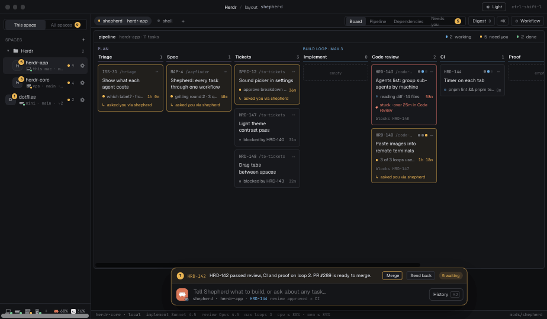

# Shepherd for Herdr

A Herdr layout that turns your agents into a software factory. You talk to one agent per space, **Shepherd**. Shepherd runs every task through a fixed workflow built on [mattpocock/skills](https://github.com/mattpocock/skills), starts the sub-agents, and only brings you the questions that need you. A board shows where every task is at all times.

```
Plan         Triage → Grill → Spec / wayfinder → Tickets
Build loop   Implement → Code review → CI → Proof      (max 3 loops, then Shepherd asks you)
Ship         Ready to merge → Done
```



## Status

Built: slices 1–9 and 10a–10l in [docs/SLICES.md](docs/SLICES.md). Each slice's **Built:** line says what was checked live and what wasn't. [RECIPE.md](RECIPE.md) describes the build as it is, including what isn't built (*Watch out*).

## Start here (for an agent working on it)

1. Read `~/.config/herdr-app/AGENTS.md` (`herdr-app --skill`) and `hc --skill`. They are the truth for this Herdr version.
2. Read [RECIPE.md](RECIPE.md): what the person sees and how it behaves.
3. Read [docs/CONVENTIONS.md](docs/CONVENTIONS.md): labels, stages, files and messages that tie the pieces together.
4. Open `docs/design/Shepherd.dc.html` in a browser to see the target. It is an HTML prototype with simulated data.
5. Work one slice from [docs/SLICES.md](docs/SLICES.md) at a time. Run `herdr-app check mods/shepherd` after every change. `agents/` has the `hc` templates used to build the slices.

## Design screenshots

From the prototype at 1440px wide, in `docs/design/screenshots/`: board, task overview, review grid, needs you, dependencies, history (⌘J), digest, steer menu, terminal, and the light (paper) theme. GitHub org avatars show blank in the captures.


## About the design files

The files in `docs/design/` are **design references made in HTML**, not code to ship. Herdr mods are written in gpui-kit (JavaScript describing native GPUI elements): no HTML, no CSS, no DOM. Recreate the layout, colors, type and behavior with gpui-kit and the `herdr` module, and use `theme()` colors instead of the hex values so the layout follows light and dark themes. The prototype's numbers (times, tokens, costs, CPU) are simulated.

**Superseded on grilling:** the prototype's grilling rounds and nine columns predate the Grill step; RECIPE.md is the truth there (a Grill column, one question at a time). **Fidelity: high.** Spacing, type sizes, colors and copy are final. Where the prototype does something Herdr can't (hover peek with a timer, drag and drop of spaces), see *Watch out* in RECIPE.md.

## Install

Link, don't copy: the mod finds the Shepherd agent (`shepherd/start.sh`, `workflow.json`) through its `mods/shepherd` link (`cd -P`), and `bin/shep.mjs` beside the workflow file start.sh labels Shepherd with, so a copied mod can't start or talk to Shepherd.

```sh
git clone https://github.com/codebypanduro/herdr-shepherd ~/code/herdr-shepherd
ln -s ~/code/herdr-shepherd/mods/shepherd ~/.config/herdr-app/mods/shepherd
ln -s ~/code/herdr-shepherd/layouts/shepherd.json ~/.config/herdr-app/layouts/shepherd.json
herdr-app check ~/.config/herdr-app/mods/shepherd
```

Merge the `layout:shepherd` section of `keys.json` into `~/.config/herdr-app/keys.json`, then switch to the layout with `ctrl-shift-l`. Or ask your agent:

```
❯ Read ~/.config/herdr-app/AGENTS.md, then add this layout: https://github.com/codebypanduro/herdr-shepherd. Clone it and link mods/shepherd and layouts/shepherd.json instead of copying them.
```

To start a space's Shepherd, click **Start Shepherd** under the board on ✻ Shepherd (also ⌘J, the + menu and Space settings; a message written with no Shepherd starts one too), or run `~/code/herdr-shepherd/shepherd/start.sh` in a terminal of that space. On another machine it needs a checkout there: **Set up Shepherd on <machine>** clones this repo into `~/.herdr-shepherd` on it after asking. It needs `node`, `hc`, `claude` and `git`, and `gh` for PRs. Your settings go to `shepherd/workflow.json` (made from `workflow.example.json`, git-ignored).

## Sharing

Add the GitHub topic `herdr-layout`, keep `RECIPE.md` and `preview.png` current, and it shows up at herdr.dev/layouts.

## Repo

```
layouts/shepherd.json          the window: sidebar · tab bar · board + detail over Shepherd's terminal (or a tab, full size) · status bar
mods/shepherd/                 one mod, every panel (props.view / props.panel): board, pipeline, dependencies,
                               needs you, task detail (its Terminal tab the agent's own terminal), digest, steer, the spaces
                               sidebar with machines and usage, New space, Add machine, Workflow and Space settings
keys.json                      the layout:shepherd keys to merge into ~/.config/herdr-app/keys.json
shepherd/                      the Shepherd agent: PROMPT.md, start.sh, workflow.example.json, bin/shep.mjs, bin/load.sh,
                               usage/ (weekly Claude and Codex % for the sidebar)
agents/                        hc templates for building slices (slice-builder, code-review)
docs/                          recipe support: conventions, slices, design prototypes
preview.png                    the layout with demo spaces and a real Shepherd run's tasks on the board
```
