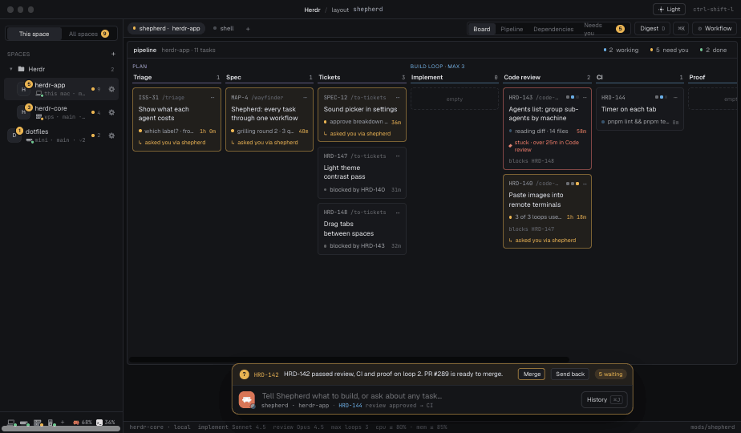

# Shepherd

A board for a software factory. Each space has one Shepherd agent that you talk to through a floating bar at the bottom. Shepherd takes every task through Plan (triage, grill, spec, tickets), a Build loop (implement, code review, CI, proof; at most 3 times) and Ship (ready to merge, done). Sub-agents never talk to you; their questions come to you through Shepherd, in a Needs you list, as toasts and on your phone.

## What you see

The window, left to right and top to bottom. All sizes at zoom 1. Colors are theme names, with the graphite hex the prototype uses in brackets. The board's status colors are the design's hues from the ANSI colors, not Herdr's own status colors (which differ by theme): working blue `ansi4`, needs you amber `ansi3`, done green `ansi2`, idle `idle`.

**Title bar**: Herdr's own, with the window buttons. The layout puts nothing in it.

**Sidebar** (240px, `chrome`, right border `border`).
- **SPACES** header (11px, `dim` #6c6f77) with a **+** button. The + opens a 210px menu: *New space from folder…* (N) and *New folder* (F).
- Folders: ▶/▼ chevron, folder icon (`accent` when open), name, space count. A collapsed folder shows the amber question count of the spaces inside it; an empty one shows "Drag spaces here" and a ✕ to remove it. *New folder* adds a row with a name field at the top (Enter makes it, Esc cancels).
- Space rows (6px 8px padding, 26px left inside a folder, radius 6px; selected row `hover` #1e2025): a 24px org avatar (the GitHub org image, radius 6px; the space's first letter on `raised` without one). An amber badge with the open question count sits on the avatar's top-right corner. Next to it the name (13px), and under it the machine icon + machine name · branch · ⑂ worktree count (10.5px mono, `dim`; clicking the machine opens its popover). On the right a status dot (amber with open questions, blue pulsing with a working task) with the open task count, and a ⚙ that opens Space settings. Click selects the space.
- Drag a space row onto a folder to put it in (the folder gets an accent border while you're over it); while a foldered space is dragged, a dashed "Drop here to take it out of the folder" area appears under the list.
- Footer row: one icon per machine (this computer first, then `machines()`; MacBook, Mac mini, server, tower; a status dot in the corner: green, amber when cpu or disk ≥ 80%, grey when unreachable) and a **+** to add a machine. On the right, the weekly Claude % and Codex %, each with its agent's icon, only where a usage command is set (Watch out). Clicking a machine or the usage opens a 260px popover with the details.

**Tab bar** (36px, `chrome`, bottom border `border`). A pill "shepherd · <space>" with a status dot, a pill per other tab ("shell", or its name), any sub-agents kept as tabs (address and task id, with ✕), and +. The layout has no terminal area, so clicking a pill opens that terminal in the terminal window; + makes a new shell tab. On the right:
- view switch: **Board · Pipeline · Dependencies · Needs you** (Needs you has an amber count)
- **Digest** (D)
- **⌘K** (Herdr's command palette)
- **⚙ Workflow** (opens Workflow settings)

**Main area** (6px padding, 6px gap). The board pane takes the free width. When a task is open, a detail pane sits on its right (620px, min 380px). Both panes have radius 6px and a 1px `border`. The floating bar sits over the bottom of both panes.

**Board pane header** (32px): "pipeline", "<space> · N tasks", then three status filters: ● N working, ● N need you, ● N done. Click one to show only that status; several can be on at once; ✕ clear resets.

**Board.** Ten columns, min 172px each, scrolling sideways:
- PLAN (purple `ansi5`; the prototype's oklch(0.74 0.11 290)): Triage, Grill, Spec, Tickets.
- BUILD LOOP · MAX 3 (blue `ansi4`; oklch(0.74 0.11 245)): Implement, Code review, CI, Proof.
- SHIP (green `ansi2`; oklch(0.75 0.12 155)): Ready to merge, Done.

Each group's label sits above its first column, and the column header (title and card count) has a 2px underline in the group color. An empty column shows a dashed "empty" box. **Card** (10px padding, radius 6px, `surface` #17181c, 1px `border`):
- Top row: id (11px mono, `muted` #9b9ea6), the current skill (`/implement`, `/code-review`…, the workflow's skill for the stage where it names one, so Grill shows `/grill-me` when that is picked; 10.5px mono `dim`), loop dots in build-loop stages (one 6px square per allowed loop: done loops grey, current loop in the status color, unused loops dark), then ⋯ (steer; only on cards with a task or a terminal address).
- The title (13px, line-height 1.35).
- A status dot plus the last note, and on the right the time in this stage (10.5px mono).
- Optional lines: "stuck · over 50m in Implement" (red, with a small red square), "after HRD-143" (mono, `dim`; a queued ticket says "blocked by HRD-143" as its note instead), and "↳ asked you via shepherd" (amber). The time turns red when stuck and amber when it has waited on you over 30m.
- Card background and border by state: blocked has an amber tint and border, stuck a red border, selected an accent border, keyboard focus a 1px accent ring.

**Pipeline view**: one row per task (needs you first, then working, queued, done), with a cell per stage: ✓ for passed stages, the agent's terminal id (or "needs you", "ready", "paused", "parked") in the current stage, tinted in its status color (red when stuck), blank ahead. Loop dots sit on the right. Click opens the task, right-click steers it.

**Dependencies view**: chains of tickets left → right with arrows, each in a box headed "HELD UP BY YOU · N waiting" (amber; the chain's first unfinished task waits on you), "IN PROGRESS · N waiting" or "CLEARED · N waiting". Held-up chains come first. A task waiting on two others shows in both chains.

**Needs you view**: one card per open question (max-width 760px):
- A kind chip in its group color with an icon: triage (⏷), grilling (?), approve tickets (list), question (?), loops used up (↻), ready to merge (merge icon).
- The task id and title, then where it is ("Code review · loop 3/3", "Grill · question 4").
- The question (14px), and who asked it with the last finding.
- Answer buttons, with the recommended one marked "recommended", and the asker's one-line reason for it under them when it gave one (grilling questions do).
- A free-text reply field.
- Grilling questions come one at a time, each an ordinary card: the next one arrives after you answer.
- Approve-tickets cards list the proposed tickets and what each one waits on.

**Task detail pane.**
- Header: id, title and ✕; under them a stage chip in its group color (merge icon for Ready to merge, ✓ for Done), "loop 2/3" (build-loop stages), cost, and a terminal chip (▭ t6; click peeks at it).
- Worktree line: ⑂ branch · machine:~/.herdr/worktrees/<repo>/<branch>.
- Tabs (switch with 1–5): **Overview · Review · Changes · Files · Proof**.
  - **Overview**:
    - Ready-to-merge tasks start with a PR card: PR number (or "Local merge · no remote"), branch → main, diff size, every GitHub check with its time, Shepherd's CI and Proof results, then **Squash and merge** and **Send back** (once Shepherd has asked) and "Open on GitHub ↗".
    - Shepherd's summary (14px).
    - A timeline bar: one segment per stage per loop, width ∝ time, colored by result (pass green, fail red, running blue and pulsing, asking amber). Loop labels sit above it, each loop's stage names under it, and totals (time, tokens, $) below.
    - Comments: each stage run's note ("<role> · <model>", the stage and loop) and each finding (reviewer, file:line). Each has a 3px color mark (the run's result color, purple for findings) and a state chip (open for a failed run; a finding's open, fixing or resolved).
  - **Review**:
    - A grid with one row per finding and one column per loop. Cells read found / still open / fixing / ✓ fixed, and the current loop's column is shaded.
    - Then a loop-by-loop list: what the implementer did, what review said, and counts of new, fixed and carried findings.
  - **Changes**: the list of changed files (+/−) on the left, a unified diff on the right.
  - **Files**: the worktree's file tree (folders first, ▸/▾), with a small mark per row colored by extension (grey for folders). Changed files are marked A/M. Clicking a file shows it with line numbers and its added lines highlighted.
  - **Proof**: the headless-browser checks (✓/✕ with a note), a grid of 260px screenshots, and an "Open <recording>" button.

**Floating Shepherd bar.** A floating block on `work`, bottom center, 780px wide; Herdr places it (its floating inset) and draws its frame.
- When questions are open, a top strip with an amber line under it shows the oldest one: its task id, the question, and up to 3 answer buttons (the recommended one marked), or **Answer…** (opens Needs you) when it has no options, and an amber "N waiting" chip (opens Needs you) when there are more.
- The main row (56px): the Shepherd avatar (a 32px `accent` tile with ✻ and Shepherd's status dot, pulsing while it works), a 15px input "Tell Shepherd what to build, or ask about any task…", and under it "shepherd · <space> · <last event>" (click: History), or "no Shepherd in this space · run shepherd/start.sh in a terminal here". A **History ⌘J** button sits on the right.

**Status bar** (24px, mono 11px `dim`): herdr-core · <machine or local>, implement model, review model, max loops, then "cpu 34% ≤ 80%" and "mem 61% ≤ 85%": the space's machine now against the workflow's limits, red at or over the limit (read every 15 s). "mods/shepherd" on the right.

**Overlays.**
- **History window** (⌘J, the bar's **History ⌘J** button, or clicking the bar's last-event line; a 760px dialog, 85% of the window high): a 44px header (Shepherd's status dot, "Shepherd · <space>", its address and the message count, an amber "N waiting on you" chip that opens Needs you, esc), the full chat oldest first, scrolled to the newest, and a ❯ input at the bottom that talks to Shepherd. Your messages are in a tinted box with ❯. Shepherd's start with ⏺, and events with ⎿ and the task id in its tone color (each stage run's start, then its result and note). Questions appear inline with answer buttons (the recommended one marked, its reason under it); answered ones show "↳ you: <answer>".
- **Terminal** (T, or a tab-bar pill; a 900×640 window; the title bar holds the keyboard when it opens: S steers, Esc closes; clicking the title bar or footer takes the keyboard back from the terminal): a 40px title bar (status dot, address, role · model · task, where it runs, **Keep as tab** for a terminal without a pane (no `herdr.tab`), **Steer**, ✕), the real terminal, and a 30px footer that names what it shows: a task's agent ("You talk to the agent through Shepherd…" with time in stage, tokens and cost), "Shepherd's own terminal.", or another one ("The shell tab in <space>: what you type goes straight to it."). Drag it by the title bar. ✕ and Esc close it by its key, `shepherd-terminal`.
- **Steer menu** (⋯, S or right-click; 290px popup headed by the id, terminal and role): Pause/Resume (P; greyed unless working or paused), Redirect… (R), Add context… (C), Ask for status (S), Open terminal (T; greyed without one), Open task (↵). Redirect and context open a text field: "Send to t6" (Enter sends). Ask for status sends `status <id>?` and opens the History, where Shepherd's reply appears.
- **Peek** (the design's hover peek) is not built; ⋯ on a card without a task opens Herdr's `terminal.peek`, as does the detail header's terminal chip.
- **Digest** (D, a 720×480 dialog): "Today · <space> · Tue 17 Nov"; shipped, in flight, waiting on you (with the oldest wait), today's spend and tokens; then Shipped, Stuck, Most expensive (with a bar) and "Needed more than one loop". Today counts tasks with a stage run since local midnight; rows open the task.
- **Command palette** (⌘K).
- **Workflow settings** (⚙ Workflow or W; a 680px dialog, 85% high): the title "Workflow" with "Matt Pocock's flow · <skills>" under it, the `npx skills add` line with the tracker, then one row each (mark, title with its skill in mono, a one-line description, controls on the right): ✳ Shepherd model, 01 Triage model, 02 Grill ("Grills you until you agree. No limit."; chips `/grill-with-docs` and `/grill-me`, and its model), 03 Spec ("Writes the spec from the grilling."), 04 To tickets ("Asks you to approve"), 05 Implement model, 06 Code review model, 07 CI ("Set per space: ⚙ on each space"), 08 Proof (Screenshots, Screen recording), ↻ Max build loops (1–5), ! When an agent needs you (Toast, Sound, Phone), ∥ Machine load limits: Max CPU 60/70/80/90% and Max memory 70/80/85/95% as chips (selected chip `foreground` on `background`; a value set by hand shows as an extra chip), then a box with one row per machine: icon and name, a cpu and a mem bar (4px, `muted`, amber within 10 of the limit, red at it, a 1px tick at the limit) and "N running", "N running · near" or "at limit". A note in amber when the shown space overrides the limits. Footer: the file it writes (`shepherd/workflow.json`) and **Done**. Every click writes at once and sends each Shepherd on this computer `workflow changed: read <file>`; the Shepherd row's description says a new model applies after a restart.
- **Space settings** (⚙ on a space row; a 600px dialog, 85% high): the name as a field (Enter or leaving it renames the space; empty goes back to Herdr's name), the machine icon with `machine:path`, the remote · branch. Rows: CI checks (a mono field, saved on Enter or leaving it; empty means no CI for this space), Folder (chips: No folder and each folder), Machine (chips with each machine's cpu, the space's own selected; read-only: a space lives on one machine), Shepherd (`claude · <model> · <address>`, or **Start Shepherd** when none runs, on any machine: checked when the dialog opens, "Checking…" meanwhile, greyed with "Can't start here: <reason>" and Retry when the machine didn't answer; "Starting…" and disabled while start.sh runs), Issue tracker, then Machine load limits for this space (as in Workflow settings, plus **Same as workflow**, and only this space's machine's row). Footer: `.herdr/orchestra.json` and **Done**.
- **New space** (+ → New space from folder…, or N; `shepherd.new-space:<machine>` opens it on a machine; a 560px dialog): an "On" row of machine chips (this mac, then every non-temporary machine; this mac picked), a `~/` filter field, the git repos found on the picked machine under ~/code, ~/src, ~/Projects and the like and beside that machine's spaces (each with its path, remote or "no remote · local only", and branch; repos that already are spaces there are left out; one scan per machine, 15 s here and 20 s on another machine, "Looking for git repos…" (this mac) or "reading <machine>…" meanwhile, a red "Couldn't reach <machine>: …" line with **Retry** when it fails; picking that chip again also scans again). A machine whose core is unavailable has a dim "<machine> · unavailable" chip and says so at once, without trying. Typed text that looks like a path (has a `/` or starts with `~`), or matches no repo, is offered as a folder on that machine (absolute, `~/…`, or under its home), checked when added; the field's `~/` prefix hides when the text starts with `/` or `~`. Then "Put in" folder chips, a **Start Shepherd** check (off by default; greyed with "Can't start Shepherd on <machine>: <reason>." when start.sh can't run there, with Retry when the check couldn't reach it; while it's ticked and the check is still running, Add space waits), **Choose in Finder…** (this mac only; the system picker, adds at once), Cancel and **Add space** (`space.new` with that machine and the folder's real path). Enter in the filter adds the first row. A folder that isn't one there, or a machine that doesn't answer, shows a red line and keeps the dialog open; a folder that already is a space on that machine (also through a symlink) selects that space with a toast instead of making another.
- **Add machine** (footer +; a 540px dialog): SSH host (with hints: Host names from ~/.ssh/config that aren't machines yet), Name in Herdr (default: the host's first part, the user for an IP host, else "box"; letters, digits, . _ - only), Kind (Detect, Server, MacBook, Mac mini, Desktop; Detect uses what the machine reports), Temporary sandbox, the `hc machine add --name <name> [--temp] <host>` line with Copy (macOS `pbcopy`), a red line when the name is taken or invalid or the host starts with -, then **Add machine**, which runs it. While it runs, a step list: Connecting over SSH (●), Checking herdr-core, Installing herdr-core if it's missing, Finding agents: claude, codex (○). On failure the failing step gets a red ✕ (Connecting when hc says unreachable, else Checking), then hc's message and hint and "run the command above in a terminal". On success the dialog closes with an "Added <name>" toast.
- **Machine popover**: icon, name, model, "N agents", cpu / mem / disk bars, INSTALLED (Claude Code, Codex, with their weekly %).
- **Usage popover**: "Usage this week · resets Mon", one row per tool with its detail, % and a bar.
- **Toasts**: Herdr's own (`notify()`); Herdr decides where they show and for how long.

## How it behaves

**Statuses.** Agents report over OSC 7501. working (blue, pulsing dot), blocked (amber: it needs you), done (green), idle (grey). A task's status is its current agent's. Paused (grey) is Shepherd's own.

**The flow.**
- **Triage.** Issues from other people start in Triage (`/triage`). Shepherd asks you for a label (needs-info / ready-for-agent / ready-for-human / wontfix) and recommends one; ready-for-agent goes on to Grill.
- **Grill.** Work you ask for skips triage and starts in Grill (`/grill-with-docs`, which also keeps a glossary, `CONTEXT.md`, and decisions, `docs/adr/`, as it goes, in the plan folder; `/grill-me` in Workflow settings). The first ticket of the plan brings those docs into the code. A griller asks you one question at a time through Shepherd, each with options and a recommended answer, the next built on your answer, with no limit, until you both agree (its last question asks exactly that).
- **Spec.** `/to-spec` (`/wayfinder` when it's too big for one session) writes the spec from the grilling and the docs it made, without grilling again. If something is still open it asks one more question the same way.
- **Tickets.** `/to-tickets` proposes vertical slices with blocking edges, the first one a prefactor. You approve or ask to merge them. The tickets appear in Tickets as ready-for-agent, or "blocked by X".
- **Build loop.** A ticket starts when its blockers are done **and** its space's machine is under the CPU and memory limits (`shep room`, measured where Shepherd runs: the space's machine when start.sh ran in a terminal of that space, as it should); otherwise Shepherd sets its note to "waiting for room on vps" and runs `shep room --wait` in an hc terminal, whose exit tells it to try again. Then Implement (`/implement`) → Code review (`/code-review`) → CI (the space's command) → Proof (headless browser: screenshots and a recording).
  - A review finding or a failing check sends the ticket back to Implement and uses a loop.
  - After the last loop Shepherd asks you: One more loop / Park it / I'll take it.
- **Ship.** On a pass Shepherd opens a PR and asks to merge. Merge squashes it and removes the branch and worktree. Send back returns the ticket to Implement.

**Questions** from any sub-agent (the griller's too) go to Shepherd, which shows them:
- in Needs you
- in the bar
- in the history
- as a toast with a sound and a phone push, each of which can be turned off in Workflow → When an agent needs you

**Spaces.**
- One Shepherd per space. Choosing a space filters the board, Needs you, the chat and the digest to it.
- Spaces live on one machine. To run on another, make a new space there (New space's machine chips; Space settings shows the machine read-only).
- Folders are only for the sidebar (shared state, this screen). Drag a space onto a folder to put it in. While you drag a foldered space, a "Drop here to take it out of the folder" area appears. The folder can also be set in Space settings or picked in New space.

**Keys** (only in this layout, never global):
- ⌘K palette
- ⌘J history
- G then B / P / D / N for the views
- J / K (or ↓ / ↑) to move between cards, ↵ to open one, Esc to close it
- A to accept the recommended answer (or Merge / Approve)
- S steer, P pause, T terminal
- C new task (the bar takes the keyboard with "add " typed)
- D digest (again: closes it)
- N new space, F new folder (shows the sidebar if hidden), W workflow settings, U weekly usage
- 1–5 task tabs
- Esc closes the top overlay
- ⌘⇧D digest, ⌘⌥1–4 the four views, ↓ / ↑ like J / K: not in the design, added for this build
- Not built: R (reply to the next question)
- Esc closes, in order: the steer popup, digest or History (Herdr closes the top dialog or popup), the terminal window (only while its title bar has the keyboard), then the open task, then the keyboard focus on the board

**Stuck.** A working task goes stuck past its stage's limit: triage 40m, grill 30m, spec 2h, tickets 1h, implement 50m, review 25m, CI 20m, proof 20m (`stuckMinutes` in workflow.json; the space's orchestra.json wins). Time in stage counts from the stage run's start in tasks.json; the stuck clock restarts at your last answer in the stage, so a long grilling isn't stuck while it waits on you.

**Steering** goes through Shepherd as lines (see CONVENTIONS): `pause <id>` / `resume <id>`, `steer <id> redirect: …`, `steer <id> context: …`, `status <id>?`. Shepherd forwards them to the task's agent. A paused card reads "paused by you".

## Built from

- **Layout** `layouts/shepherd.json`, a root row (theme `paper` light, `graphite` dark; 1px `border` dividers):
  - `sidebar` (column, px 240, min 40, max 360): a block `spaces` (mod `shepherd`, props `{panel:"spaces"}`)
  - `work` (column), containing:
    - `tabs` (px 36, mod `shepherd`, props `{panel:"tabs"}`)
    - `main` row (gap 6, padding 6) of `board` (mod `shepherd`, props `{view:"board"}`) and `detail` (px 620, min 380, mod `shepherd`, props `{panel:"detail"}`, hidden until a task is open); both radius 6 with a 1px `border`
    - `status` (px 24, mod `shepherd`, props `{panel:"status"}`)
    - floating on `work`: `bar` (mod `shepherd`, props `{panel:"bar"}`, edge bottom, align center)
- **Shepherd agent**: one per space, started by `shepherd/start.sh [--space <id>] [repo]`: `hc run --bg --keep --outlive-parent --no-parent --name shepherd-<id lowercased to a-z0-9, max 20 chars> --cwd <repo> --label herdr.space=<id> --label herdr.tab=shepherd-<id> --label herdr.role=shepherd --label shepherd.dir=<repo> --label shepherd.workflow=<workflow file> -- env SHEP_FILE=<tasks.json> SHEP_WORKFLOW=<workflow file> claude --model <workflow shepherd.model, default opus> --disallowedTools AskUserQuestion --append-system-prompt-file <PROMPT.md with paths filled in> "<first message>"`. Before that it exits if the space already has a live Shepherd, adds `.herdr/` to the repo's git exclude and runs `shep init`. It changes tasks.json only through `shepherd/bin/shep.mjs`. It starts sub-agents with `hc run --bg` and labels them (see CONVENTIONS), reads their reports from its input (`<hc from=…>`), and writes task state to `.herdr/shepherd/tasks.json` in the repo.
- **Overlays** are the same mod with other props: the + menu (popup, `{panel:"plus"}`), the machine and usage popovers (popup, `{panel:"machine", machine}`, `{panel:"usage"}`), New space, Add machine, Workflow settings and Space settings (dialogs, `{panel:"newspace"}`, `{panel:"addmachine"}`, `{panel:"workflow"}`, `{panel:"spacesettings", space}`), the steer menu (`openOverlay` popup, `{panel:"steer", task}`), the digest (dialog, `{panel:"digest"}`), and the terminal window (`kind:"window"`, key `shepherd-terminal`, a column layout: `{panel:"term", terminal, task}` 40px, `{terminal}`, `{panel:"termfoot", …}` 30px).
- **Keys**: `keys.json` in this repo has the `layout:shepherd` section (⌘K palette, ⌘J History, ⌘⇧D digest, ⌘⌥1–4 views as `shepherd.<command>`); merge it into `~/.config/herdr-app/keys.json`. Plain letters (J K G S P T A C D N F W U 1–5 ↵ Esc) are the board's own `on_key_down`, only while the board (not Needs you) holds the keyboard. `mod.json` has `"focusable": true`, so `pane.go` and a closing popup hand the board the keyboard back (`"focus"` from `nextCommand()`).
- **History** reads `.herdr/shepherd/chat.jsonl` (`shep say`, appended): the board records every line it sends Shepherd (bar, History input, steer, pause, status), and Shepherd records what it tells the person. Events and questions come from tasks.json.
- **Sidebar data**: the sidebar copy runs `mods/shepherd/machine.sh` on every machine every 15 s (its text through `exec("sh", ["-c", …], {on})`: cpu, mem, disk, and once kind and model) and `knownAgents({on})` once for Claude Code / Codex (8 s timeouts; a machine still busy from the last round is skipped); the results are merged into shared `shepherd.machineInfo` for the popovers and settings. Each space's org, branch and worktree count come from git every 60 s, six spaces at a time; org images are downloaded once to `data/shepherd-avatars/<org>.png` with curl. Folders are shared `shepherd.folders` and `shepherd.spaceFolders`, kinds picked in Add machine `shepherd.machineKinds`, New space's pending space `shepherd.newSpace`. It reads tasks.json of every space with a Shepherd for the badges: every 5 s here, every 30 s on other machines.
- **Settings files**: there is one person's workflow file, `shepherd/workflow.json` in the checkout `~/.config/herdr-app/mods/shepherd` links to (found with `cd -P`; copied from `workflow.example.json` the first time; git-ignored). Workflow settings writes it, and the mods read it for every space on this computer. `start.sh` gives it to new Shepherds; running ones get `workflow changed: read <file>` (PROMPT.md); `shep room` reads workflow.json beside the example it was given. Spaces on another machine read workflow.json, else the file, that Shepherd's `shepherd.workflow` label names there. Space settings writes `<repo>/.herdr/orchestra.json` and adds `.herdr/` to the repo's git exclude. All writes go one at a time per file and only if the file hasn't changed since it was read: here with `writeTextFile(…, before)`, on another machine with node there (same check, a temp file of its own).
- **Mods** read `terminals()` (labels, status, address), `spaces()`, `focused()`, `machines()`, `knownAgents()`, `shared()`, `readTextFile` (also `{on: machine}`) and `watchFolder()` on the repo's `.herdr` (this computer; other machines are read every 5 s). They answer questions with `hc send <shepherd> …`, show art with `svg()` (`mods/shepherd/icons/`) and `image()`, and post phone pushes with `fetch` to ntfy.sh. Commands used: `terminal.peek`, `terminal.keep`, `terminal.park`, `tab.new`, `app.palette`, `space.new {folder, machine}` (`""` for this computer), `space.select`, `space.rename`, `layout.show/hide`, `layout.switch` (a toast's action), `notify`, `playSound("blocked")`, `openOverlay`/`closeOverlay`, `pickFolder`, `writeTextFile`. Key commands added: `shepherd.workflow`, `shepherd.usage`, `shepherd.new-space`, `shepherd.new-folder`, `shepherd.add-machine`, `shepherd.machine:<name>`, `shepherd.space-settings[:<space id>]`.
- **Programs run**: `hc machine add` (Add machine), `shepherd/start.sh` (Start Shepherd, on the space's machine), `find` and `git config` (New space, on the picked machine), a login shell on another machine (`$SHELL -lc`, `-lic` only when that lacks node, hc, claude or git; to read its PATH for Start Shepherd), `curl` (org images), `pbcopy` (Copy), `node` (writes on another machine), the person's usage commands, `git worktree`, `gh pr` (PR, checks, merge), `shepherd/bin/load.sh` (CPU from `ps` and memory from `vm_stat` on macOS, `/proc/stat` and `/proc/meminfo` on Linux) through `exec … {on: machine}` for the status bar and through `shep room` for Shepherd, the space's CI command, and Claude or Codex for usage.

## Watch out

- The prototype is HTML. Mods can't use CSS or timers to animate: use `.loop("opacity", …)` for pulsing dots and `.frames()` for spinners.
- Hover peek needs `.on_hover` plus a short `cx.timer` delay; cancel it on leave.
- Dragging spaces between folders has no built-in drop target in mods; use press, move and release on the rows, or offer the Folder picker only at first.
- Keys must go in `keys.json` under `"layout:shepherd"`, never global, and must not take plain letters while a terminal has focus.
- Weekly Claude and Codex usage isn't in Herdr, and neither CLI has a usage command a script can read. The person sets one per tool in workflow.json, `"usage": {"claude": "<command>", "codex": "<command>"}`, printing a percent (and optionally a detail line); it runs every 5 minutes in a login shell. Without a command, or when no machine has the tool, that tool's usage is hidden (and with neither, the footer shows none).
- The design's **This space | All spaces** toggle isn't built: the board, Needs you and History read one space's tasks.json, and task ids repeat across repos. Each space row's badge shows its open questions instead.
- Render the sidebar from one `terminals()` and one machine list per render: calling them per row (40 spaces) made the render slow enough that Herdr kept the last version with "This view could not be re-rendered … interrupted".
- Dragging is press, move (4 px) and release on the rows: a folder row or the drop area takes the release; anywhere else ends the drag. A drag released on its own row doesn't select it.
- Add machine runs `hc machine add` without a terminal, so ssh can't ask for a password or a new host key; it shows hc's message and hint, and the command to run in a terminal.
- Changing a space's machine isn't offered: a space lives on one machine (make a new space there).
- Start Shepherd on another machine needs a herdr-shepherd checkout there (found through that machine's `~/.config/herdr-app/mods/shepherd` link, else at this checkout's path) with `shepherd/start.sh` and `bin/shep.mjs`, and node, hc, claude and git on its login shell's PATH (a plain `sh -c` over hc lacks ~/.nvm and ~/.local/bin). The mod asks once per dialog (`shepherdOn`; again on Retry or after the machine didn't answer) and runs start.sh there with that PATH; New space greys its check with the reason, Space settings greys its button with it. A start runs once per space at a time from one dialog ("Starting…"): start.sh's own check for a running Shepherd is check-then-act.
- Popovers opened by a key or `shepherd.<command>` open at a fixed spot near the sidebar's foot (the pointer may be anywhere).
- Added beyond the design: the U key and `shepherd.usage`, `usage` commands in workflow.json, Add machine's Copy button and Detect kind, a space row's machine label opening its popover, ✕ on an empty folder, Start Shepherd in New space and Space settings, and "Same as workflow" for a space's limits.
- `herdr-app check` renders only the board (no props). To check the other panels, check a scratch copy of the mod with `props()` replaced by a fixed `{panel: …}` for each one.
- `run()` returns nothing, so New space can't name the space it made: it leaves `shepherd.newSpace` {machine, folder, real path, ids before, group, start} in shared state, and the sidebar takes the first space id that wasn't there before and sits in that folder on that machine, then files it and starts Shepherd if asked. After a minute without one it gives up with a toast.
- `cd` into the `mods/shepherd` link and then `..` goes back up the link's own path: use `cd -P` to find the checkout.
- Install by linking `mods/shepherd` and `layouts/shepherd.json` from a checkout, not by copying them: the mod finds `shepherd/` (start.sh, shep.mjs, load.sh, workflow.json) through that link. A copied mod draws, but can't find start.sh (Start Shepherd) or the workflow.json Workflow settings writes and every local space reads.
- Don't run `/triage` on tickets made by `/to-tickets`; they are agent-ready.
- The timeline and digest need real start and end times per stage: Shepherd must record them in tasks.json.
- Plan purple is `theme().ansi5`: there is no purple theme color, and deriving one from `accent` needs color math the mods don't have.
- Until Shepherd writes tasks.json (slice 2), the board reads only labels: `shepherd.task` (id), `shepherd.stage`, `shepherd.loop`, optional `shepherd.title`. Time in stage is counted by the mod from when it first sees a terminal in a stage (its `created_ms` on first sight), so it resets when the mod reloads.
- The first Shepherd in a new repo stops at Claude's folder-trust dialog; accept it in its tab (or `hc keys <t> down enter`). Worktrees under `~/.herdr/worktrees` haven't asked.
- The floating frame is Herdr's: the bar can't turn its border amber or glow. It shows waiting questions with an amber line under the question strip instead.
- Questions alert only while the Shepherd layout is shown (the bar copy does it, once per question, remembered in shared `shepherd.alerted`). Questions older than 15 minutes on first sight don't alert.
- Phone push goes through ntfy.sh: set `alerts.phone: true` and `alerts.ntfy: "<topic>"` in workflow.json or the space's `.herdr/orchestra.json`. Off by default, since the question text goes to that server.
- `InputState.new` can't run in `render`: Needs you uses a pool of 12 reply fields made in `init`; a 13th open question gets buttons only.
- The detail pane is the layout's `detail` block, shown with `layout.show {id:"detail"}` when a task card is clicked and hidden by ✕ or clicking the card again. Its width is a fixed 620px (min 380), not min(620px, 54%).
- Comments are built from tasks.json: each stage run's note (by role and model) and each finding (reviewer, file:line, state). There is no separate comment store.
- Changes and Files compare the worktree with `git merge-base HEAD main` (or master), committed or not, plus untracked files; they reload every 10 s while shown. Long files stop at 3000 lines.
- Timeline segments flex by their share of total time (at least 2%), and running segments pulse. Hovering a segment shows nothing yet.
- The planning skills (/to-spec, /to-tickets, /triage, the grill skills) publish to an issue tracker and talk to the user. Planners are told to follow their method but write files and ask through Shepherd instead, never in their terminal or with a question tool.
- The grilling skill itself asks in rounds (the whole frontier at once), and the person's own CLAUDE.md says grilling asks through AskUserQuestion. The griller's message opens (after the skill) with a paragraph that overrides both: one question at a time, only through Shepherd. Every planner also starts with `claude --disallowedTools AskUserQuestion` (before `--model`: the flag takes several values and `--model` ends the list). Each question is a `grill-<n>.json` file Shepherd turns into `shep ask --kind grill --question <file>`, so option text may hold a `|`.
- `/grill-with-docs` keeps its glossary and decisions in `.herdr/shepherd/plans/<id>/docs/` (`CONTEXT.md`, `adr/`), seeded by Shepherd from the repo's own copies, never in the repo: the griller runs in the repo itself, and a dirty tree there would block Ship's local merge. Shepherd copies them into the plan's first ticket's worktree (`CONTEXT.md`, `docs/adr/`) and commits them there before Implement, so they reach main with that ticket's PR or merge. Nothing is committed straight to main. The griller writes links as they'll be in the repo (`docs/adr/<file>` from CONTEXT.md), and the ticket planner is told not to make a ticket for copying them.
- A skill in an agent's message runs only as the message's first word (`/to-spec`, `/to-tickets`, the grill skills have `disable-model-invocation`): "Now /to-spec …" doesn't load it.
- The griller's last question, "Have we reached a shared understanding?", recommends "Yes, write the spec", so A ends the grilling like any recommended answer; anything else keeps it going.
- Grilling has no limit on questions: only the person and the griller agreeing ends it. The old rounds (`round <qid>: …`, `shep ask --questions`, Workflow's questions-per-round) are gone; an old round question in a tasks.json shows its questions read-only while open (answer in the reply field, as 1. … 2. …), and its text and answer once answered.
- A person's existing `shepherd/workflow.json` (git-ignored) keeps its old values and they still win: `grillQuestionsPerRound` there is ignored, and it has no `stages.grill` until Workflow settings writes one (the default skill and model apply).
- An agent reused for the next Plan stage is relabelled with `hc label` (griller → planner, `shepherd.stage=spec`).
- Every request goes through Grill and Spec, however small, unless the person says to skip planning; without that rule Shepherd skips planning for anything that looks easy.
- A blocker counts as finished only when its task is in `done` (merged), so tickets behind a task in Ready to merge wait until the merge.
- `gh pr merge --delete-branch` can't delete a branch a worktree still has checked out: remove the worktree first, then check the remote branch is gone.
- `hc` names allow only lowercase letters, digits, - and _: name agents `<id lowercased>-impl-<loop>`.
- No remote: Ship merges locally (`git merge --squash` + commit), only when the repo is on main with a clean tree.
- Proof screenshots are copied to `~/.config/herdr-app/data/shepherd-proof/` because `image()` only reads under the app's home; remote spaces show checks but not screenshots.
- The PR card shows GitHub's checks from `gh pr view --json statusCheckRollup`, plus Shepherd's own CI and Proof results.
- `shep`'s own path option is `--tasks`; `--file` belongs to `finding add` (the finding's file).
- Plain-letter keys in `keys.json` would also fire while you type in the bar: the board takes them itself with a focus handle (`track_focus` + `on_key_down`) when clicked or handed `"focus"`. It doesn't take the keyboard on load, so a reload never steals it from the bar or a terminal. Needs you gets no board keys at all: its reply fields would bubble into them.
- C asks the bar for the keyboard with `run("shepherd.focus-bar")`: a mod command reaches every shown copy, and only the bar acts on it.
- D and ⌘J toggle through shared `shepherd.digestOpen` / `shepherd.historyOpen` (the open copy's overlay id, cleared in its `close()`). If an overlay goes without `close()`, the next press only clears the stale id; press again.
- Answers aren't chat lines: the History shows them under their question. Shepherd's own terminal output isn't the History either; only what it records with `shep say`.
- A popup opened from a key or a `shepherd.<command>` can't use the pointer (it may be outside the window): the steer menu then opens at a fixed spot near the board's top left.
- The terminal window isn't read-only: Herdr has no read-only terminal block, and clicking into the terminal gives it the keyboard (then Esc goes to the agent: close with ✕, or click the title bar or footer first). Its footer says to talk through Shepherd instead.
- A window isn't a dialog or popup: `overlay.close` with no id (and Herdr's Esc) closes the top dialog or popup, never the terminal window. Close it by its key: `closeOverlay("shepherd-terminal")`, or `herdr-app do overlay.close --id shepherd-terminal`.
- Every shown copy of the mod gets every command from `nextCommand()` (`shepherd.<command>` goes to all of them). So a copy must never re-send (`run("shepherd.…")`) the command it just received: every copy gets it again and sends it again, and Herdr loops until it crashes. The board did that with `new-folder` (it ran `shepherd.new-folder` on receiving it); fixed in e44d2df: the board ignores `new-folder`, and only its own F key goes through `overlayCommand`. Pick one copy to act on each command and have the others return.
- Inline Inputs in the sidebar work: New folder is a row with a name field at the top of the sidebar (focused once it has rendered), not a dialog. A dialog version was tried and reverted.
- `load.sh` reads `ps` %CPU on macOS, a decaying average, not an instant sample; memory counts active + wired + compressed pages.
- The status bar finds `load.sh` next to Shepherd's workflow file (its `shepherd.workflow` label), so a space without a Shepherd shows the limits without numbers.
- Hover peek is not built: ⋯ on a label-only card (no task) still opens `terminal.peek`.
- Not built from the design: the Overview's "Ask Shepherd about <id>…" field, the Claude/Codex icon on comments and a Claude/Codex Shepherd avatar (the bar shows ✻), the bar's amber border and focus glow (Herdr draws the floating frame), the 108px bottom padding (the bar can cover the lowest cards), the R key, timeline hover and hover peek.
- Herdr writes `jsconfig.json` and `gpui-kit.d.ts` into each mod folder; they are git-ignored.

## Done when

- Asking Shepherd "add a timer to each tab" creates a task in Grill, asks you one question at a time in Needs you and the bar until you agree, writes the spec, and shows tickets to approve.
- An approved ticket gets its own worktree and goes Implement → Code review. A review finding sends it back with loop 2/3 on the card, and the Review tab shows the finding as found then fixed.
- A ticket that fails review three times asks you One more loop / Park it / I'll take it.
- A passing ticket shows Ready to merge with its PR checks, and Merge squashes it and removes the worktree.
- When a sub-agent asks something, you get a toast and a sound (and a phone push with `alerts.phone` and `alerts.ntfy` set), plus an amber badge on its space.
- With the machine over the CPU limit, ready tickets wait with "waiting for room on <machine>" and start once it drops.
- A working task past its stage limit shows "stuck · over 50m in Implement" in red on its card, in Pipeline and in the digest.
- T opens a working agent's real terminal, and S → Redirect sends it new instructions through Shepherd.
- Switching to a light Herdr theme keeps every color readable (no hard-coded hex).
